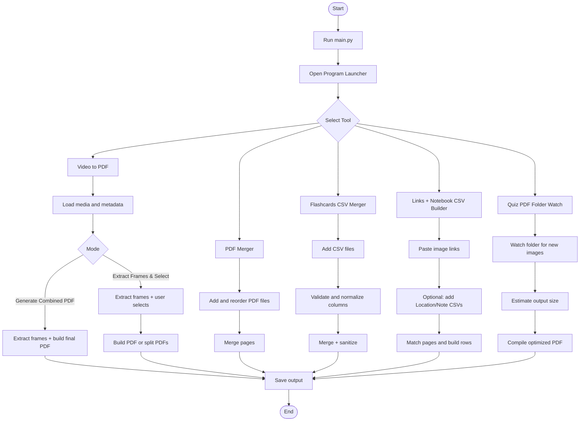

# Learning Tools Suite

Desktop Python tools for converting videos/images/documents into clean study-ready PDFs and merged CSV outputs from a single launcher.


## Project Description

This repository contains a modular desktop toolkit focused on study/content-processing workflows:

- convert videos into PDFs using frame extraction presets
- merge multiple PDFs with ordering support
- merge CSV content for flashcards/highlights
- merge pasted image links with CSV Location/Note data
- build optimized PDFs from watched image folders

The project is organized around a single root entry point (`main.py`) that opens a launcher UI, while application logic is separated into modules for maintainability and testability.

### Why these technologies were chosen

- **Tkinter**: native Python GUI toolkit with zero external runtime dependency for desktop forms and controls.
- **OpenCV (`opencv-python`)**: robust frame extraction and image manipulation from videos.
- **ReportLab**: reliable PDF generation with direct image placement and page customization.
- **pypdf**: efficient PDF read/merge/write operations.
- **pandas**: straightforward CSV ingestion/transformation for tabular merge workflows.
- **pytest**: fast, readable automated tests for utility and integration checks.

### Challenges solved in the codebase

- **Import reliability in modular launch flows** by launching tools as Python modules (`python -m ...`) rather than path-based scripts.
- **Output safety and data hygiene** with filename sanitization and spreadsheet formula-escape logic.
- **Large-media processing usability** through presets, progress feedback, and size estimation/splitting logic.
- **Separation of concerns** via layered structure (`modules/core`, `modules/apps`, `modules/launcher`) with tests targeting reusable logic.

## Table of Contents

- [Project Description](#project-description)
- [Project Structure](#project-structure)
- [Installation](#installation)
- [Usage](#usage)
- [Program Flow (Activity Diagram)](#program-flow-activity-diagram)
- [Tests](#tests)
- [Contributing](#contributing)
- [License](#license)
- [References](#references)

## Project Structure

```text
learning/
├─ main.py
├─ apps/
│  ├─ flashcards.py
│  ├─ image_links_and_notebooklm.py
│  ├─ merge_pdf.py
│  ├─ quiz_pdf.py
│  └─ video_to_pdf.py
├─ modules/
│  ├─ apps/
│  ├─ core/
│  └─ launcher/
├─ tests/
├─ requirements.txt
└─ README.md
```

## Installation

### 1) Prerequisites

- Python **3.10+**
- Windows recommended (current workflows and tested environment)

### 2) Clone the repository

```bash
git clone https://github.com/hamzasiyam/learning.git
cd learning
```

### 3) Create and activate a virtual environment

```bash
python -m venv .venv
# PowerShell
.venv\Scripts\Activate.ps1
```

### 4) Install dependencies

```bash
pip install -r requirements.txt
```

### 5) Install optional dependency for image-folder PDF tool

`apps/quiz_pdf.py` requires Pillow:

```bash
pip install pillow
```

### Dependency list (from project)

- `opencv-python`
- `reportlab`
- `pypdf`
- `pandas`
- `tkinterdnd2`
- `pytest`
- `pillow` (required for quiz/folder-watch PDF workflow)

## Usage

### Launch all tools from the single root entry point

```bash
python main.py
```

This opens the launcher UI and lets you start each tool.

### Run tools directly (module mode, recommended)

```bash
python -m apps.video_to_pdf
python -m apps.merge_pdf
python -m apps.flashcards
python -m apps.image_links_and_notebooklm
python -m apps.quiz_pdf
```

### Typical workflow examples

- **Video to PDF**: choose a preset, add video/PDF queue, generate combined PDF or extract/select frames before export.
- **PDF Merger**: add PDFs, reorder, merge, then open output location.
- **Flashcards CSV Merger**: provide title/author, add CSVs, export normalized combined CSV.
- **Links + Notebook CSV Builder**: paste image links, merge with `Location`/`Note` CSV files, export final CSV.
- **Quiz PDF**: watch folder for new images, estimate output size, compile optimized PDF.

## Program Flow (Activity Diagram)



## Tests

Run the full test suite:

```bash
python -m pytest -q
```

Run a specific test module:

```bash
python -m pytest -q tests/test_launcher_and_entrypoints.py
```

## Contributing

Contributions are welcome.

1. Fork the repository
2. Create a feature branch (`git checkout -b feature/your-change`)
3. Make your changes with tests and clear docstrings/comments
4. Run tests locally (`python -m pytest -q`)
5. Commit with meaningful messages
6. Open a pull request describing:
   - what changed
   - why it changed
   - how it was tested

## License

This project is licensed under the **MIT License**. See the `LICENSE` file for details.

## References

> "This README was structured based on the principles outlined in How to Write a Good README File for Your GitHub Project (https://www.freecodecamp.org/news/how-to-write-a-good-readme-file/
) by freeCodeCamp."

